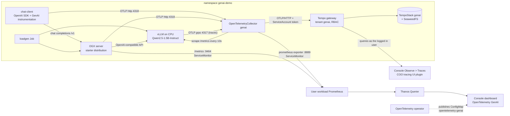

# GenAI observability on OpenShift

An LLM stack observed end to end with OpenTelemetry on OpenShift:

- **vLLM** serves `Qwen2.5-1.5B-Instruct` on CPU (no GPU needed), behind **OGX** (the upstream project formerly called Llama Stack).
- A **chat client** calls OGX using the OpenTelemetry GenAI instrumentation.
- One **OpenTelemetryCollector** receives traces, metrics and logs, and exports traces to a multi-tenant **TempoStack** and metrics to user workload monitoring.
- You get two views in the OpenShift console: **Observe > Dashboards > OpenTelemetry GenAI** (requests, tokens, latency, errors, OGX and vLLM) and **Observe > Traces** (one trace across client, OGX and vLLM).

The dashboard is shipped by the **OpenTelemetry operator**, like its existing "OpenTelemetry Collector" dashboard.
This needs an operator build with our GenAI change, so the setup below starts with that.



## Requirements

- OpenShift 4.20 or newer (tested on 5.0), cluster-admin, `oc`, and `operator-sdk` for the operator step. [Chainsaw](https://kyverno.github.io/chainsaw/latest/quick-start/install/) >= v0.2.12 is optional.
- One worker with **at least 16 vCPU and 32 GiB** and AVX-512 (for example `m5.4xlarge`). The whole demo needs about 15 vCPU, 25 GiB of memory and 45 GiB of storage.
- Internet access from the cluster (Docker Hub, Hugging Face, PyPI, ghcr.io, quay.io) and the Red Hat Operators catalog.

## Setup

### 1. Install the OpenTelemetry operator with the GenAI dashboard

Use **our fork and branch**, either as the pre-built image or built yourself. The change is on the branch
[`genai-dashboard`](https://github.com/IshwarKanse/opentelemetry-operator/tree/genai-dashboard) of
[IshwarKanse/opentelemetry-operator](https://github.com/IshwarKanse/opentelemetry-operator) (upstream `main` plus the dashboard; not submitted upstream).

**Option A, the pre-built image** (fastest). Public images built from that branch, amd64:
`quay.io/rhn_support_ikanse/opentelemetry-operator:genai-2` and the bundle `quay.io/rhn_support_ikanse/opentelemetry-operator-bundle:genai-2`.

```bash
oc create namespace opentelemetry-operator-system
oc label namespace opentelemetry-operator-system openshift.io/cluster-monitoring=true
operator-sdk run bundle quay.io/rhn_support_ikanse/opentelemetry-operator-bundle:genai-2 \
  --namespace opentelemetry-operator-system --timeout 6m --security-context-config=restricted
```

**Option B, build the branch yourself** (use your own quay.io namespace and make the repositories public):

```bash
git clone https://github.com/IshwarKanse/opentelemetry-operator.git && cd opentelemetry-operator
git checkout genai-dashboard
export IMG=quay.io/<your-namespace>/opentelemetry-operator:genai
export BUNDLE_IMG=quay.io/<your-namespace>/opentelemetry-operator-bundle:genai
IMG=$IMG BUNDLE_VARIANT=openshift make bundle
IMG=$IMG BUNDLE_IMG=$BUNDLE_IMG BUNDLE_VARIANT=openshift GOOS=linux GOARCH=amd64 ARCH=amd64 \
  DOCKER_BUILDX_FLAGS="--platform=linux/amd64" make container container-push bundle-build bundle-push
# then the same oc and operator-sdk commands as in option A, with $BUNDLE_IMG
```

On Apple Silicon, add `${DOCKER_BUILDX_FLAGS}` to the `docker build --load` lines of the Makefile first, and build in a throwaway copy of the repository because `make bundle` rewrites tracked files.

If another OpenTelemetry operator is already installed, remove it first (two operators cannot own the same CRDs), or keep it and publish the dashboard yourself with
`genai-observability/dashboard/load-dashboard.sh`; everything else in the demo works with any recent OpenTelemetry operator.

### 2. Deploy the demo

With Chainsaw (allow 30 to 40 minutes, mostly model download and start):

```bash
chainsaw test --skip-delete genai-observability
```

It runs these steps in order, each one waiting until its part is ready: check the OpenTelemetry operator, enable user workload monitoring, install the **Tempo operator**,
install the **Cluster Observability Operator**, install the OGX operator, deploy the storage and the multi-tenant TempoStack, create the **tracing UI plugin** (Observe > Traces),
deploy the collector, vLLM, OGX and the chat client, start the load, then verify traces, metrics and the dashboard ConfigMap.

Or by hand, from the repository root:

```bash
D=genai-observability

# prerequisites: namespace, user workload monitoring, Tempo operator, Cluster Observability Operator, OGX operator
oc apply -f $D/00-cluster/namespace.yaml -f $D/00-cluster/user-workload-monitoring.yaml \
  -f $D/00-cluster/tempo-operator.yaml -f $D/00-cluster/coo-operator.yaml
oc apply -f https://raw.githubusercontent.com/ogx-ai/ogx-k8s-operator/v0.17.0/release/operator-openshift.yaml

# tracing: storage, multi-tenant TempoStack with gateway RBAC, Observe > Traces
$D/01-tracing/create-storage-secret.sh
oc apply -f $D/01-tracing/seaweedfs.yaml && oc rollout status deploy/seaweedfs -n genai-demo
oc apply -f $D/01-tracing/tempostack.yaml -f $D/01-tracing/rbac.yaml -f $D/01-tracing/traces-ui-plugin.yaml

# collector, then vLLM (wait until ready), then OGX, the client and some load
oc apply -f $D/02-collector/rbac.yaml -f $D/02-collector/otel-collector.yaml
oc apply -f $D/03-inference/vllm.yaml && oc rollout status deploy/vllm -n genai-demo --timeout=25m
oc apply -f $D/04-ogx/ogxserver.yaml -f $D/05-app/chat-client.yaml -f $D/06-load/loadgen.yaml
```

`00-cluster/user-workload-monitoring.yaml` is a cluster-wide ConfigMap; on a cluster that already has a `cluster-monitoring-config`, merge `enableUserWorkload: true` into it instead.
Deploy vLLM before OGX: OGX registers the model only if vLLM is already serving when it starts.

### 3. Warm up and verify

The **first request after a vLLM start takes 5 to 10 minutes** on CPU (kernel compilation, once). The chat client sends requests by itself; wait until it logs a completed answer
(`oc logs -n genai-demo deploy/chat-client`). Then run the three checks:

```bash
D=genai-observability
oc apply -f $D/07-verify/verify-traces.yaml && oc logs -f job/verify-traces -n genai-demo   # one trace across client, OGX and vLLM
$D/07-verify/check_metrics.sh                                                               # every dashboard metric has data
$D/07-verify/check_dashboard.sh                                                             # the dashboard ConfigMap exists
```

### 4. Look at it

- **Dashboard:** console **Observe > Dashboards**, pick **OpenTelemetry GenAI**, project **All Projects**.
- **Traces:** console **Observe > Traces**, instance `genai-demo / genai`, tenant `genai`. Open a `chat-client` trace for the waterfall (client, OGX, vLLM).
- **Prompts and completions:** `oc logs -n genai-demo deploy/genai-collector`.

## What is in this directory

| Path | Content |
|---|---|
| `00-cluster/` | namespace, user workload monitoring, Tempo and Cluster Observability operator subscriptions |
| `01-tracing/` | SeaweedFS storage, multi-tenant TempoStack, gateway RBAC, the Observe > Traces plugin |
| `02-collector/` | the OpenTelemetryCollector |
| `03-inference/`, `04-ogx/` | vLLM and the OGX server |
| `05-app/`, `06-load/` | the chat client and the load generator |
| `07-verify/` | trace, metrics and dashboard checks |
| `dashboard/` | the dashboard JSON and a loader script (a copy of the file embedded in the operator branch) |
| `docs/` | [how the demo works](docs/how-it-works.md) (components, dashboard panels, demo script, variations) and [GenAI semantic conventions](docs/genai-semantic-conventions.md) |
| `chainsaw-test.yaml` | the whole demo as a Chainsaw test |

## GenAI semantic conventions in short

OpenTelemetry defines an open standard for describing generative AI calls: the [GenAI semantic conventions](https://opentelemetry.io/docs/specs/semconv/gen-ai/) (`gen_ai.request.model`, `gen_ai.usage.input_tokens`,
`gen_ai.client.operation.duration` and more). They are still in **Development** status, so names change between versions. In this demo the chat client follows them through the OpenTelemetry instrumentation
`opentelemetry-instrumentation-genai-openai`, vLLM follows them partly (the collector renames its span attributes), and OGX and vLLM expose their own metrics.
OpenTelemetry also ships GenAI instrumentation libraries for Python, Java and JavaScript. Read [docs/genai-semantic-conventions.md](docs/genai-semantic-conventions.md) for the details, the instrumentation list, and OpenInference and OpenLLMetry.

## Troubleshooting

| Symptom | Fix |
|---|---|
| First chat request hangs for minutes, then the client logs `Request timed out` | Expected once after each vLLM start (CPU kernel compilation); vLLM still finishes the request. |
| vLLM crash loops with `VLLM_PORT ... appears to be a URI` | The Service named `vllm` makes Kubernetes inject `VLLM_PORT`. The manifest sets `enableServiceLinks: false`; keep it. |
| Client logs `waiting for the model list`, OGX lacks `vllm/qwen2.5-1.5b` | OGX started before vLLM was ready: `oc rollout restart deploy/genai -n genai-demo`. |
| Dashboard shows `-` or no data | Open it with Project: All Projects and wait for the first request to complete; run `07-verify/check_metrics.sh`. |
| Dashboard is missing | The operator was not installed from our branch or image; run `dashboard/load-dashboard.sh`. |
| Tempo pods crash loop right after creation | The storage is not ready yet; they recover on their own once `deploy/seaweedfs` is ready. |
| `403 You don't have permission to access this tenant` when reading traces | With gateway RBAC, readers need the tenant rule (`01-tracing/rbac.yaml`) and access to the namespace; cluster admins see everything. |
| Observe > Traces has no Tempo instance | Check `oc get uiplugin` and refresh the console; the plugin needs the Cluster Observability Operator. |
| `Pending` pod with insufficient CPU | vLLM requests 12 CPU; it needs a worker with at least 16 vCPU. |

More in [docs/how-it-works.md](docs/how-it-works.md).

## Cleanup

```bash
D=genai-observability
oc delete namespace genai-demo
oc delete -f $D/01-tracing/traces-ui-plugin.yaml -f $D/00-cluster/coo-operator.yaml -f $D/00-cluster/tempo-operator.yaml
oc delete -f https://raw.githubusercontent.com/ogx-ai/ogx-k8s-operator/v0.17.0/release/operator-openshift.yaml
```

The operator removes its dashboard ConfigMaps when it stops. User workload monitoring stays enabled.

## Status and limitations

- Verified manually step by step on OCP 5.0 (AWS): one trace across the three services, all dashboard panels with data, and the three checks passing. The whole Chainsaw test passes against that cluster (about 80 seconds, with everything already deployed); a run from scratch on an empty cluster was not done.
- The operator is unreleased upstream `main` (0.162.0) plus our change; the collector is the upstream contrib image. Neither is a product release.
- The GenAI conventions and the GenAI instrumentation libraries are in development; names and packages can change.
- Demo shortcuts: S3 traffic between Tempo and SeaweedFS is cleartext inside the cluster, there is no NetworkPolicy for it, and prompts and completions are recorded.
- CPU inference is slow by design; the demo is about the telemetry. Not tested: GPU nodes, a non-admin user in Observe > Traces, other OpenShift versions.

Tested with: OpenShift 5.0, OpenTelemetry operator 0.162.0, collector contrib 0.162.0, Tempo 2.10 (operator 0.22.0-4), Cluster Observability Operator 1.5.3, vLLM 0.32.0, OGX operator v0.17.0, `opentelemetry-instrumentation-genai-openai` 1.3b0.

## References

- OpenTelemetry [GenAI semantic conventions](https://opentelemetry.io/docs/specs/semconv/gen-ai/), the [specification repository](https://github.com/open-telemetry/semantic-conventions-genai) and the [Python GenAI instrumentation](https://github.com/open-telemetry/opentelemetry-python-genai)
- [OpenTelemetry operator](https://github.com/open-telemetry/opentelemetry-operator) and [our fork, branch genai-dashboard](https://github.com/IshwarKanse/opentelemetry-operator/tree/genai-dashboard)
- [vLLM](https://docs.vllm.ai/en/stable/examples/observability/opentelemetry/) (OpenTelemetry tracing, [metrics](https://docs.vllm.ai/en/latest/usage/metrics.html)), [OGX](https://github.com/ogx-ai/ogx) and its [operator](https://github.com/ogx-ai/ogx-k8s-operator)
- [Tempo operator](https://github.com/grafana/tempo-operator), [Cluster Observability Operator](https://github.com/rhobs/observability-operator), [Chainsaw](https://kyverno.github.io/chainsaw/latest/)
- More links in [docs/genai-semantic-conventions.md](docs/genai-semantic-conventions.md)
