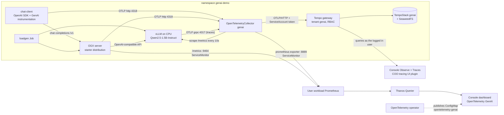

# GenAI observability on OpenShift

A complete, small LLM stack observed with OpenTelemetry on OpenShift, using the OpenTelemetry operator directly
(the Cluster Observability Operator is not part of the data path):

- **vLLM** serves `Qwen2.5-1.5B-Instruct` on CPU, so no GPU is needed.
- **OGX** (the upstream project formerly called Llama Stack) sits in front of vLLM and exposes the OpenAI-compatible API.
- A **chat client** instrumented with the OpenTelemetry GenAI instrumentation calls OGX.
- One **OpenTelemetryCollector** receives traces, metrics and logs from all three, derives request metrics from the spans and exports traces to a multi-tenant **TempoStack** and metrics to **user workload monitoring**.
- The traces are browsed in the console under **Observe > Traces**, using the tracing UI plugin of the **Cluster Observability Operator**.
- A new **"OpenTelemetry GenAI" dashboard** in **Observe > Dashboards** shows requests, tokens, latency, errors, the Llama Stack server and the vLLM engine.
  The dashboard is shipped by the OpenTelemetry operator itself, the same way the existing "OpenTelemetry Collector" dashboard is.

Contents: [Replicate in short](#replicate-in-short) · [Glossary](#glossary) · [Architecture](#architecture) · [GenAI semantic conventions](#genai-semantic-conventions) · [Repository layout](#repository-layout) · [Prerequisites and sizing](#prerequisites-and-sizing) ·
[Install](#install) · [What each piece does](#what-each-piece-does) · [The dashboard](#the-dashboard) · [Verify](#verify) ·
[Demo script](#demo-script) · [Troubleshooting](#troubleshooting) · [Variations](#variations) · [Cleanup](#cleanup) · [Status and limitations](#status-and-limitations) · [Versions used](#versions-used) · [References](#references)

## Replicate in short

1. Get an OpenShift 4.20+ cluster with a worker of at least 16 vCPU and 32 GiB (no GPU), and cluster-admin access. See [Prerequisites and sizing](#prerequisites-and-sizing).
2. Install an OpenTelemetry operator build that contains the GenAI dashboard (the branch `genai-dashboard` of the fork linked in [Install](#install)), or any OpenTelemetry operator plus `dashboard/load-dashboard.sh`.
3. Run `chainsaw test --skip-delete genai-observability`, or apply the numbered directories `00-cluster` to `06-load` in order (commands in [Install](#install)). Plan 30 to 40 minutes, most of it model download and start.
4. Send one request and wait for it (the first request on CPU takes minutes, see [Troubleshooting](#troubleshooting)), then run the three checks in `07-verify/` ([Verify](#verify)).
5. Open **Observe > Dashboards > OpenTelemetry GenAI** and **Observe > Traces**.

Read [GenAI semantic conventions](#genai-semantic-conventions) to understand which names the telemetry uses and why, and [References](#references) for the upstream documentation.

## Glossary

| Term | Meaning |
|---|---|
| **GenAI semantic conventions** | The OpenTelemetry standard names for spans, attributes, metrics and events of generative AI calls (`gen_ai.*`). See [below](#genai-semantic-conventions). |
| **vLLM** | An open-source LLM inference server with an OpenAI-compatible API, its own Prometheus metrics and OpenTelemetry tracing. |
| **OGX** | Open GenAI Stack, the upstream project formerly called Llama Stack: a server that exposes one API (chat, responses, vector stores, tools) in front of inference providers such as vLLM. |
| **OpenInference, OpenLLMetry** | Third-party OpenTelemetry-based instrumentation libraries for LLM apps with their own attribute names; see [below](#instrumentation-that-does-not-use-the-conventions). |
| **TTFT** | Time to first token: the delay between the request and the first generated token. |
| **KV cache** | The attention key/value memory vLLM keeps per running request; when it is full, requests queue. |
| **Span metrics** | Request rate, errors and duration derived from traces by the collector's `span_metrics` connector. |
| **Tenant** | In Tempo's multi-tenant mode, an isolated trace namespace with its own access rules; this demo has one, `genai`. |
| **UIPlugin** | A resource of the Cluster Observability Operator that adds a page to the OpenShift console (here Observe > Traces). |

## Architecture



A request takes this path: the client calls OGX, OGX calls vLLM. The OpenAI SDK uses httpx, and the httpx instrumentation
adds the W3C `traceparent` header, so the client, OGX and vLLM spans end up in **one trace**.

| Signal | Produced by | Path to the dashboard |
|---|---|---|
| Traces | client (GenAI spans), OGX (FastAPI and provider spans), vLLM (`llm_request` span with latency breakdown) | collector, then the Tempo gateway (Observe > Traces) |
| Request metrics (RED) | derived in the collector from the spans by the `span_metrics` connector, with `gen_ai.request.model`, `gen_ai.operation.name` and `gen_ai.provider.name` as extra dimensions | collector Prometheus exporter, then user workload monitoring |
| GenAI client metrics | the client instrumentation: `gen_ai.client.token.usage`, `gen_ai.client.operation.duration`, time to first chunk, time per output chunk | OTLP, collector, Prometheus exporter |
| Llama Stack server metrics | OGX: `ogx_inference_*`, `ogx_concurrent_requests`, `ogx_requests_total` | scraped from OGX `/metrics` through the ServiceMonitor the OGX operator creates |
| vLLM engine metrics | vLLM `/metrics`: tokens, TTFT, inter-token latency, KV cache, queue | scraped by the collector (`prometheus/vllm` receiver) |
| Collector health | the collector's own telemetry (`otelcol_*`) | ServiceMonitor created by the OpenTelemetry operator |
| Logs | prompt and completion log events (`gen_ai.user.message`, `gen_ai.choice`) | collector logs pipeline, `debug` exporter only (no log store in this demo) |

## GenAI semantic conventions

OpenTelemetry defines an open standard for describing generative AI operations: the **GenAI semantic conventions**. They give spans, attributes, metrics and events the same names whichever
library produced them and whichever backend consumes them, so one dashboard or alert works across providers and frameworks (`gen_ai.request.model` instead of a different name per vendor).
The conventions are developed by the OpenTelemetry GenAI special interest group in the repository [semantic-conventions-genai](https://github.com/open-telemetry/semantic-conventions-genai)
and published on [opentelemetry.io](https://opentelemetry.io/docs/specs/semconv/gen-ai/).

**Status: Development.** The conventions are not stable yet. Names and structure still change between versions (this demo already shows two generations of the token metric, see below),
and instrumentation packages are pre-1.0 or beta. Pin versions and expect to adapt queries and dashboards when you upgrade.

### What the specification covers

| Area | What it defines | Specification |
|---|---|---|
| Overview and status | scope and stability | [README](https://github.com/open-telemetry/semantic-conventions-genai/blob/main/docs/gen-ai/README.md) |
| Client inference | spans, events and metrics of a chat or completion call | [client-inference](https://github.com/open-telemetry/semantic-conventions-genai/blob/main/docs/gen-ai/client-inference.md) |
| Embeddings | spans and metrics of embedding calls | [client-embeddings](https://github.com/open-telemetry/semantic-conventions-genai/blob/main/docs/gen-ai/client-embeddings.md) |
| Model spans | span name, kind and attributes of model operations | [gen-ai-spans](https://github.com/open-telemetry/semantic-conventions-genai/blob/main/docs/gen-ai/gen-ai-spans.md) |
| Agent spans | `invoke_agent`, `create_agent`, tool execution, workflows | [gen-ai-agent-spans](https://github.com/open-telemetry/semantic-conventions-genai/blob/main/docs/gen-ai/gen-ai-agent-spans.md) |
| Metrics | client and server metrics, for example operation duration, time to first token | [gen-ai-metrics](https://github.com/open-telemetry/semantic-conventions-genai/blob/main/docs/gen-ai/gen-ai-metrics.md) |
| Token metrics | input and output token counters, cache and reasoning tokens | [gen-ai-token-metrics](https://github.com/open-telemetry/semantic-conventions-genai/blob/main/docs/gen-ai/gen-ai-token-metrics.md) |
| Events | prompts, completions and other inputs and outputs | [gen-ai-events](https://github.com/open-telemetry/semantic-conventions-genai/blob/main/docs/gen-ai/gen-ai-events.md) |
| Exceptions | errors of GenAI operations | [gen-ai-exceptions](https://github.com/open-telemetry/semantic-conventions-genai/blob/main/docs/gen-ai/gen-ai-exceptions.md) |
| Provider specifics | OpenAI, Anthropic, Azure AI Inference, AWS Bedrock | [openai](https://github.com/open-telemetry/semantic-conventions-genai/blob/main/docs/gen-ai/openai.md), [anthropic](https://github.com/open-telemetry/semantic-conventions-genai/blob/main/docs/gen-ai/anthropic.md), [azure-ai-inference](https://github.com/open-telemetry/semantic-conventions-genai/blob/main/docs/gen-ai/azure-ai-inference.md), [aws-bedrock](https://github.com/open-telemetry/semantic-conventions-genai/blob/main/docs/gen-ai/aws-bedrock.md) |
| Protocols | Model Context Protocol and Agent2Agent | [mcp](https://github.com/open-telemetry/semantic-conventions-genai/blob/main/docs/gen-ai/mcp.md), [a2a](https://github.com/open-telemetry/semantic-conventions-genai/blob/main/docs/gen-ai/a2a.md) |

The attribute registry (all `gen_ai.*` keys with types and examples) is on [opentelemetry.io](https://opentelemetry.io/docs/specs/semconv/registry/attributes/gen-ai/).
To get started read the overview, then client inference, spans and metrics.

### The names this demo relies on

| Name | Kind | Meaning |
|---|---|---|
| `gen_ai.operation.name` | span and metric attribute | Operation type: `chat`, `embeddings`, `generate_content`, `retrieval`, `execute_tool`, `invoke_agent`, `create_agent`, `invoke_workflow` |
| `gen_ai.provider.name` | attribute | Provider of the model API, for example `openai` or `vllm` |
| `gen_ai.request.model`, `gen_ai.response.model` | attribute | Model asked for and model that answered |
| `gen_ai.usage.input_tokens`, `gen_ai.usage.output_tokens` | span attribute | Tokens in the prompt and in the completion |
| `gen_ai.client.operation.duration` | histogram, seconds | Duration of a client call |
| `gen_ai.client.token.usage` | histogram, with `gen_ai.token.type` = `input` or `output` | Token usage as emitted by the installed instrumentation (schema 1.37) |
| `gen_ai.client.inference.usage.input_tokens`, `...output_tokens` | counters | The newer replacement of the token histogram in the current specification |
| `gen_ai.client.operation.time_to_first_chunk`, `...time_per_output_chunk` | histograms, seconds | Streaming latency as emitted by the installed instrumentation |
| `gen_ai.server.request.duration`, `gen_ai.server.time_to_first_token`, `gen_ai.server.time_per_output_token` | histograms, seconds | Server-side metrics defined by the specification; the servers in this demo expose their own metric names instead |

In Prometheus the dots become underscores and units are appended, for example `gen_ai_client_operation_duration_seconds_bucket`, and attributes become labels (`gen_ai_request_model`).
The dashboard queries in `dashboard/genai-dashboard.json` use these Prometheus names.

### Which part of the demo follows the conventions

| Component | Follows the conventions? | Details |
|---|---|---|
| Chat client | Yes | `opentelemetry-instrumentation-genai-openai` 1.3b0 emits GenAI spans and the `gen_ai.client.*` metrics, with schema URL 1.37.0 on the instrumentation scope |
| OGX server | Not for its metrics | Emits HTTP server spans and its own metrics (`ogx_inference_*`, `ogx_concurrent_requests`, `ogx_requests_total`); no GenAI attributes were observed on its spans in this setup |
| vLLM | Partly | Spans use older names, which the collector fixes (below); its metrics are its own `vllm:*` Prometheus metrics, not `gen_ai.server.*` |
| Collector | Adds the missing pieces | `transform/vllm-semconv` renames vLLM span attributes; `span_metrics` turns every span with GenAI attributes into request, error and latency metrics per model |

**vLLM span attributes rewritten by the collector** (`transform/vllm-semconv` in `02-collector/otel-collector.yaml`):

| vLLM emits | Collector writes |
|---|---|
| `gen_ai.usage.prompt_tokens` | `gen_ai.usage.input_tokens` |
| `gen_ai.usage.completion_tokens` | `gen_ai.usage.output_tokens` |
| `gen_ai.response.model` (no request model) | also `gen_ai.request.model` |
| nothing | `gen_ai.operation.name` = `chat` and `gen_ai.provider.name` = `vllm` |

### Instrumentation settings that matter

| Setting | Effect |
|---|---|
| `OTEL_INSTRUMENTATION_GENAI_CAPTURE_MESSAGE_CONTENT` | Whether prompts and completions are recorded. For `opentelemetry-instrumentation-genai-openai` the values are `no_content` (default), `span_only`, `event_only` and `span_and_event`; verify against the changelog of the version you use. The demo sets `span_and_event` on the client and `true` on OGX. **Prompts and completions can contain personal or confidential data; turn this off or filter it in production.** |
| `OTEL_SEMCONV_STABILITY_OPT_IN=gen_ai_latest_experimental` | Needed by the older, now deprecated `opentelemetry-instrumentation-openai-v2` package to emit the newer attribute shapes. The demo uses the newer package, which does not need it. |
| `OTEL_METRIC_EXPORT_INTERVAL` | Metric export period in milliseconds; the demo uses 5000 so that dashboards react quickly (default 60000). |

### Instrumentation that does not use the conventions

Two popular open-source projects instrument LLM applications with OpenTelemetry but predate the standard and use their own attribute names:
[OpenInference](https://github.com/Arize-ai/openinference) (Arize AI, for example `llm.token_count.prompt`, `llm.model_name`, `openinference.span.kind`) and
[OpenLLMetry](https://github.com/traceloop/openllmetry) (Traceloop, for example `llm.usage.prompt_tokens`, `llm.request.model`, `traceloop.span.kind`).
A dashboard written for the GenAI conventions cannot read their data directly.

The upstream collector-contrib component [`gen_ai_normalizer`](https://github.com/open-telemetry/opentelemetry-collector-contrib/tree/main/processor/genainormalizerprocessor)
(alpha, traces only) rewrites their attributes to the GenAI conventions, and lets you define mappings for other sources:

```yaml
processors:
  gen_ai_normalizer:
    sources:
      - name: openinference
        remove_originals: true
      - name: openllmetry
        remove_originals: true
service:
  pipelines:
    traces:
      processors: [memory_limiter, k8sattributes, gen_ai_normalizer, batch]
```

It is **not used in this demo** (the demo's clients already emit the conventions) and it is not in the Red Hat build of OpenTelemetry collector today; it is part of the upstream contrib image the demo runs.
Adding an OpenInference-instrumented client plus this processor is a natural extension, see [Variations](#variations).

## Repository layout

```
genai-observability/
  README.md
  chainsaw-test.yaml          whole demo as a Chainsaw test
  dashboard/
    genai-dashboard.json      the console dashboard (copy of the file embedded in the operator branch)
    load-dashboard.sh         publishes the dashboard without the custom operator build
  00-cluster/                 namespace, user workload monitoring, Tempo operator and Cluster Observability Operator subscriptions
  01-tracing/                 SeaweedFS object storage, multi-tenant TempoStack, gateway RBAC, Observe > Traces UIPlugin
  02-collector/               OpenTelemetryCollector and the RBAC for k8sattributes
  03-inference/               vLLM Deployment, Service, PVC (+ optional SCC)
  04-ogx/                     OGXServer custom resource
  05-app/                     chat client (ConfigMap with the script + Deployment)
  06-load/                    load generator Job
  07-verify/                  trace check Job, metrics check script, dashboard check script
```

Every directory has `assert-*.yaml` files that Chainsaw uses to wait for readiness.

## Prerequisites and sizing

- OpenShift 4.20 or newer (verified on 5.0), cluster-admin, `oc`, optionally [chainsaw](https://kyverno.github.io/chainsaw/latest/quick-start/install/) >= v0.2.12 and `jq`.
- A worker with **at least 16 vCPU and 32 GiB** for vLLM, with AVX-512 (any `m5`, `m6i`, `m7i` or newer instance). No GPU.
- Internet access from the cluster: Docker Hub (vLLM, OGX), Hugging Face (model, about 3 GB, not gated), PyPI (client packages), ghcr.io (collector image), quay.io (SeaweedFS image).
- The Red Hat Operators catalog for the Tempo operator and the Cluster Observability Operator.

| Component | CPU request / limit | Memory request / limit | Storage |
|---|---|---|---|
| vLLM (`vllm/vllm-openai-cpu:v0.32.0-x86_64`) | 12 / 12 | 20Gi / 28Gi (about 21.6 GiB used in float32) | 20Gi PVC for the model cache, 4Gi memory-backed `/dev/shm` |
| OGX server (`ogxai/distribution-starter`, pinned by the OGX operator) | 1 / 2 | 2Gi / 4Gi | 5Gi PVC |
| OpenTelemetry collector (contrib 0.162.0) | 500m / 1 | 512Mi / 1Gi | none |
| TempoStack (gateway, distributor, ingester, querier, query frontend, compactor), `resources.total` limits | up to 2 | up to 4Gi | 10Gi PVC (ingester) |
| SeaweedFS (S3 storage for Tempo) | 100m / 1 | 256Mi / 1Gi | 10Gi PVC |
| chat client | 100m / 500m | 256Mi / 512Mi | none |
| load generator | 100m / 500m | 128Mi / 256Mi | none |
| **Total** | **about 15 vCPU** | **about 25 GiB** | **45 GiB** |

The demo was built and verified on OCP 5.0 on AWS with 3 control plane nodes (`m6i.xlarge`) and 4 workers (`m5.4xlarge`, 16 vCPU and 64 GiB each).
Only one worker is really needed for vLLM; the others host everything else.

## Install

### 1. The OpenTelemetry operator

The dashboard is embedded in the operator, so the demo needs an operator build that contains it.
The change is on the branch `genai-dashboard` of the fork [IshwarKanse/opentelemetry-operator](https://github.com/IshwarKanse/opentelemetry-operator/tree/genai-dashboard)
(on top of upstream `main`; not submitted upstream).
It adds `internal/openshift/dashboards/genai-dashboard.json`, publishes it as ConfigMap `opentelemetry-genai` next to the existing `opentelemetry-collector` one,
removes both on shutdown and has unit tests. The OpenShift bundle already sets `OPENSHIFT_CREATE_DASHBOARD=true`.

**Option A, build the fork** (what the demo used):

```bash
git clone https://github.com/IshwarKanse/opentelemetry-operator.git && cd opentelemetry-operator
git checkout genai-dashboard
export IMG=quay.io/<your-namespace>/opentelemetry-operator:genai
export BUNDLE_IMG=quay.io/<your-namespace>/opentelemetry-operator-bundle:genai

IMG=$IMG BUNDLE_VARIANT=openshift make bundle
IMG=$IMG BUNDLE_IMG=$BUNDLE_IMG BUNDLE_VARIANT=openshift \
  GOOS=linux GOARCH=amd64 ARCH=amd64 DOCKER_BUILDX_FLAGS="--platform=linux/amd64" \
  make container container-push bundle-build bundle-push

oc create namespace opentelemetry-operator-system
oc label namespace opentelemetry-operator-system openshift.io/cluster-monitoring=true
operator-sdk run bundle "$BUNDLE_IMG" --namespace opentelemetry-operator-system \
  --timeout 6m --security-context-config=restricted
```

Notes for building on Apple Silicon: the Makefile `docker build --load` lines need `${DOCKER_BUILDX_FLAGS}` added so that the `--platform=linux/amd64`
flag is passed, and `make bundle` rewrites tracked files. Do both in a throwaway worktree, not in your branch.
The quay.io repositories must be public (or the cluster needs a pull secret).
If you only change the dashboard JSON later, rebuild just the operator image, push a new tag and patch the CSV:
`oc patch csv <csv> -n opentelemetry-operator-system --type=json -p '[{"op":"replace","path":"/spec/install/spec/deployments/0/spec/template/spec/containers/0/image","value":"<new image>"}]'`.

**Option B, any other OpenTelemetry operator** (community catalog or the Red Hat build): everything works except that the operator does not publish the GenAI dashboard.
Load it yourself:

```bash
genai-observability/dashboard/load-dashboard.sh
```

### 2. Everything else

With Chainsaw (applies each directory in order and waits for readiness; allow 30 to 40 minutes on a fresh cluster, most of it is the model download and start):

```bash
chainsaw test --skip-delete genai-observability
```

Or by hand:

```bash
D=genai-observability

# cluster prerequisites: namespace, user workload monitoring, Tempo operator, Cluster Observability Operator, OGX operator
oc apply -f $D/00-cluster/namespace.yaml -f $D/00-cluster/user-workload-monitoring.yaml \
  -f $D/00-cluster/tempo-operator.yaml -f $D/00-cluster/coo-operator.yaml
oc apply -f https://raw.githubusercontent.com/ogx-ai/ogx-k8s-operator/v0.17.0/release/operator-openshift.yaml

# tracing: object storage, multi-tenant TempoStack with gateway RBAC, then Observe > Traces
$D/01-tracing/create-storage-secret.sh        # random S3 secret key, nothing is committed
oc apply -f $D/01-tracing/seaweedfs.yaml
oc rollout status deploy/seaweedfs -n genai-demo
oc apply -f $D/01-tracing/tempostack.yaml -f $D/01-tracing/rbac.yaml
oc apply -f $D/01-tracing/traces-ui-plugin.yaml

# the collector
oc apply -f $D/02-collector/rbac.yaml -f $D/02-collector/otel-collector.yaml

# inference: start vLLM first and wait until it is ready (model download and load, 3 to 10 minutes)
oc apply -f $D/03-inference/vllm.yaml
oc rollout status deploy/vllm -n genai-demo --timeout=25m

# OGX registers the vLLM model when it starts, so deploy it after vLLM is ready
oc apply -f $D/04-ogx/ogxserver.yaml
oc apply -f $D/05-app/chat-client.yaml

# send one request and wait for it: the first request compiles CPU kernels (5 to 10 minutes), see Troubleshooting
oc apply -f $D/06-load/loadgen.yaml
```

`00-cluster/user-workload-monitoring.yaml` is a cluster-wide ConfigMap. On a cluster that already has a `cluster-monitoring-config`, merge `enableUserWorkload: true` into it instead of applying the file.

## What each piece does

### Collector (`02-collector/otel-collector.yaml`)

| Section | Configuration | Why |
|---|---|---|
| receivers | `otlp` (gRPC 4317, HTTP 4318); `prometheus/vllm` scraping `vllm.genai-demo.svc:8000` every 10 s | client, OGX and vLLM push OTLP; vLLM metrics are only available as a Prometheus endpoint |
| processors | `memory_limiter`, `k8sattributes`, `batch`, `transform/vllm-semconv` | see below |
| connector | `span_metrics` with histogram unit `s`, buckets 100 ms to 60 s, extra dimensions `gen_ai.request.model`, `gen_ai.operation.name`, `gen_ai.provider.name` | derives request rate, errors and latency per model from the traces |
| extension | `bearertokenauth` reading the ServiceAccount token | authenticates the export to the Tempo gateway |
| exporters | `otlphttp/tempo` (gateway URL for tenant `genai`, TLS with the service CA, bearer token, `X-Scope-OrgID: genai`), `prometheus` on `:8889` with `resource_to_telemetry_conversion`, `debug` | traces to Tempo, metrics to user workload monitoring |
| pipelines | traces: `otlphttp/tempo` and `span_metrics`; metrics: `otlp`, `prometheus/vllm`, `span_metrics` to Prometheus; logs: `otlp` to `debug` | |

`transform/vllm-semconv` exists because vLLM spans use the pre-stable GenAI attribute names (`gen_ai.usage.prompt_tokens`, `gen_ai.usage.completion_tokens`)
and lack `gen_ai.request.model`, `gen_ai.operation.name` and `gen_ai.provider.name`. The processor copies them to the current semantic convention names
for spans that carry vLLM's `gen_ai.request.id`, so vLLM spans line up with the client spans.

`observability.metrics.enableMetrics: true` makes the operator create the ServiceMonitors for the collector's own metrics and for the Prometheus exporter.
The collector image is the upstream contrib one (`opentelemetry-collector-contrib:0.162.0`) because the community operator injects the core image by default, which lacks several of these components.
`resource_to_telemetry_conversion` is deprecated in contrib 0.162 and still works.

### Tracing (`01-tracing/`)

Tempo runs as a **multi-tenant TempoStack** (`tenants.mode: openshift`) behind its gateway, which is what the console's tracing page needs.

- **Storage:** SeaweedFS (`seaweedfs.yaml`), an S3 gateway in one pod with the bucket `tempo`. The S3 secret key is generated when you deploy (`create-storage-secret.sh` creates the Secret `tempo-storage`, which SeaweedFS and the TempoStack both read; it keeps an existing Secret and replaces one whose key is empty or is the old public demo value); no credentials are in the repository. The upstream MinIO community image on quay.io is no longer public; the SeaweedFS image is the multi-arch build the operator e2e tests use.
- **Tenant:** one tenant, `genai` (`tempostack.yaml`). Its name appears in the gateway URL (`/api/traces/v1/genai`), in the `X-Scope-OrgID` header and in the RBAC rules.
- **Writers** (`rbac.yaml`): the collector ServiceAccount `genai-collector` has the verb `create` on resource `genai`, resource name `traces`, in API group `tempo.grafana.com`.
- **Readers:** the verb `get` on the same resource, bound to the group `genai-trace-readers` (add users with `oc adm groups new genai-trace-readers <user>`; cluster admins need no binding). With gateway RBAC enabled, readers see only the traces of the namespaces they can access
  (matched on the span attribute `k8s.namespace.name`, which the collector's `k8sattributes` processor adds); cluster admins see all traces.
  The service account `trace-reader` used by the check Job gets the `view` role in `genai-demo` for that reason.
- **UI:** `traces-ui-plugin.yaml` creates a `UIPlugin` of type `DistributedTracing`; the Cluster Observability Operator (installed by `00-cluster/coo-operator.yaml`) adds **Observe > Traces**, discovers the TempoStack and queries it as the logged in user.

### vLLM (`03-inference/vllm.yaml`)

- Image `vllm/vllm-openai-cpu:v0.32.0-x86_64`, entrypoint `vllm serve`, model `Qwen/Qwen2.5-1.5B-Instruct`, served as `qwen2.5-1.5b`, `--max-model-len=4096`.
- `--enable-auto-tool-choice --tool-call-parser=hermes` so the client's tool-call requests work.
- `--otlp-traces-endpoint` plus `--collect-detailed-traces=all` export one span per request with the queue, prefill and decode timings.
- `--dtype=float32`: the `m5` and `m6i` CPUs have AVX-512 but no bfloat16 instructions, where bfloat16 is slow. On `m7i` or newer (AMX) use `--dtype=bfloat16`.
- `VLLM_CPU_KVCACHE_SPACE=8` (GiB of KV cache) and `VLLM_CPU_OMP_THREADS_BIND=0-10` (11 compute threads, one core left over; CPU request and limit are 12).
- `HOME`, `VLLM_CACHE_ROOT`, `VLLM_CONFIG_ROOT`, `XDG_CACHE_HOME` point to the PVC or `/tmp`, because the pod runs with a random UID under the default restricted SCC and has no writable home.
- `enableServiceLinks: false`, see Troubleshooting. The pod runs without a custom SCC; `vllm-scc.yaml` is only a fallback.

### OGX (`04-ogx/ogxserver.yaml`)

The OGX operator (v0.17.0, `ogx.io/v1beta1`) reconciles an `OGXServer`. The `starter` distribution activates its vLLM provider only because `VLLM_URL` is set.
Telemetry is configured with plain environment variables (`OTEL_EXPORTER_OTLP_ENDPOINT`, `OTEL_SERVICE_NAME=ogx-server`, `OTEL_METRIC_EXPORT_INTERVAL=5000`,
`OTEL_INSTRUMENTATION_GENAI_CAPTURE_MESSAGE_CONTENT=true`). The old `telemetry:` provider and `TELEMETRY_SINKS` of Llama Stack 0.2 and 0.3 no longer exist; most blog posts still describe them.
The operator creates the Deployment `genai`, the Service `genai-service` (8321 for the API, 9464 for `/metrics`) and a ServiceMonitor.
The model is exposed as `vllm/qwen2.5-1.5b`.

### Chat client (`05-app/chat-client.yaml`)

A Python loop (script in a ConfigMap, packages installed at pod start) that sends a prompt every few seconds in three modes: plain chat, streaming chat and a tool-call request.
It uses the plain `openai` SDK against OGX and `opentelemetry-instrument` with:

- `opentelemetry-instrumentation-genai-openai` 1.3b0 (the older `opentelemetry-instrumentation-openai-v2` is deprecated) for the GenAI spans and metrics,
- `opentelemetry-instrumentation-httpx` so the trace context reaches OGX; without it the client traces stop at the client,
- `OTEL_INSTRUMENTATION_GENAI_CAPTURE_MESSAGE_CONTENT=span_and_event` to record prompts and completions on the span and as log events.

The client selects the model by the `vllm/` prefix because OGX also lists static entries for providers without credentials.

### Load generator (`06-load/loadgen.yaml`)

A Job that runs for 600 s with two workers through OGX and one worker straight at vLLM, so that every dashboard row, including the vLLM engine row, moves.

## The dashboard

The dashboard uses the console's legacy dashboard format (Grafana 5 style JSON with `rows`).
The console renders only the panel types `graph`, `singlestat`, `gauge`, `table` and `grafana-piechart-panel`, so the JSON sticks to the first four.
Tables use instant queries whose label sets must be identical so that the console can merge them into rows.

Open it with **Observe > Dashboards**, dashboard **OpenTelemetry GenAI**, project **All Projects**
(direct link path: `/monitoring/dashboards/opentelemetry-genai?project-dropdown-value=%23ALL_NS%23`).
Variables: **Collector namespace**, **Service**, **Model**.

| Row | Panels (25 in total) | Main metrics |
|---|---|---|
| Overview | requests per second, error rate, P95 request latency, output tokens per second, KV cache usage (gauge), requests running | `traces_span_metrics_calls_total`, `traces_span_metrics_duration_seconds_bucket`, `vllm:generation_tokens_total`, `vllm:kv_cache_usage_perc`, `vllm:num_requests_running` |
| GenAI client (semantic conventions) | requests per second by model and operation, token usage per second by model and type, request duration P50 and P95, time to first chunk, time per output chunk, calls by service, table of models and services | `traces_span_metrics_*` with `gen_ai_*` dimensions, `gen_ai_client_token_usage`, `gen_ai_client_operation_time_to_first_chunk_seconds`, `gen_ai_client_operation_time_per_output_chunk_seconds` |
| Llama Stack (OGX) server | inference duration P95, time to first token P95, tokens per second per request, concurrent requests | `ogx_inference_duration_seconds`, `ogx_inference_time_to_first_token_seconds`, `ogx_inference_tokens_per_second`, `ogx_concurrent_requests` |
| vLLM engine | prompt and generation tokens per second, TTFT P50 and P95, end-to-end latency P50 and P95, inter-token latency P95, requests running and waiting, KV cache and prefix cache hit rate | `vllm:*` |
| OpenTelemetry collector | spans accepted, refused and failed per second, metric points accepted and refused per second | `otelcol_*` |

Things worth knowing:

- **Metric names drift.** The GenAI semantic conventions are still in development; newer versions rename the token metric to `gen_ai.client.inference.usage.*_tokens`.
  The token panels use `... or ...` so that either name works. The demo showed the older `gen_ai_client_token_usage` histogram with a `gen_ai_token_type` label.
- **Labels.** Dots become underscores in Prometheus (`gen_ai_request_model`, `service_name`). The `namespace` label is the namespace of the collector (added by the ServiceMonitor), `k8s_namespace_name` is the workload namespace.
- **A console quirk.** A dashboard variable called `namespace` is special-cased by the console (it follows the Project dropdown). On the OCP 5.0 build used here it rendered the literal text `ALL_OPTION_KEY` and every panel that uses it was empty,
  The existing "OpenTelemetry Collector" dashboard also showed "No datapoints found" on this cluster with `namespace=ALL_OPTION_KEY` in its URL; its other variables may contribute, so the cause there is not confirmed.
  The GenAI dashboard calls its variable `collector namespace` to avoid the problem.
  The console shows the variable name (title-cased) as the dropdown label, not the `label` field.
- **vLLM metric names** use colons (`vllm:kv_cache_usage_perc`). The old `vllm:gpu_cache_usage_perc` no longer exists.
- Cost per token and similar business metrics are not included.

How the operator publishes it: `internal/openshift/dashboards/dashboards.go` embeds `metrics-dashboard.json` and `genai-dashboard.json`,
creates or updates the ConfigMaps `opentelemetry-collector` and `opentelemetry-genai` in `openshift-config-managed` (label `console.openshift.io/dashboard=true`) when the operator starts
and deletes them when it stops. To iterate on the JSON without rebuilding, edit the ConfigMap with `dashboard/load-dashboard.sh`; the operator rewrites it from the embedded file on its next start.

## Verify

```bash
# traces: through the multi-tenant gateway, all three services have traces and one chat-client trace contains ogx-server and vllm spans
oc apply -f 07-verify/verify-traces.yaml && oc logs -f job/verify-traces -n genai-demo

# metrics: every metric family used by the dashboard has series in Thanos (needs cluster-admin; creates a reader service account)
07-verify/check_metrics.sh

# the dashboard ConfigMap exists with the console label and the expected title
07-verify/check_dashboard.sh
```

Expected result of the trace check: `trace <id> services: chat-client,ogx-server,vllm` and `OK: chat-client -> ogx-server -> vllm in one trace`.

Look at it yourself:

- **Traces:** console, **Observe > Traces**, Tempo instance `genai-demo / genai`, tenant `genai`. The list shows traces such as `chat-client: chat vllm/qwen2.5-1.5b` with the number of spans per service;
  open one to see the waterfall: the client call, the OGX request handling and the vLLM `llm_request` span. Streaming requests produce traces with about 100 spans (one per chunk).
  The span attributes include `gen_ai.request.model`, `gen_ai.usage.input_tokens` and `gen_ai.usage.output_tokens`.
- **Metrics:** Observe > Metrics, for example `sum(rate(vllm:generation_tokens_total[5m]))` or
  `histogram_quantile(0.95, sum by (le, gen_ai_request_model) (rate(traces_span_metrics_duration_seconds_bucket{gen_ai_operation_name!=""}[5m])))`.
- **Prompts and completions:** `oc logs -n genai-demo deploy/genai-collector` (log events from the `debug` exporter).

Measured on the demo cluster (float32, 11 compute threads): about 7.5 generated tokens per second for a single stream, about 30 tokens per second with 4 concurrent requests,
time to first token around 0.4 to 0.6 s for streaming requests, P95 request latency about 28 s for 96 generated tokens under load, 25 s to load the model.

## Demo script

About 10 minutes.

1. **The stack** (2 min): `oc get pods,otelcol,tempostack,ogxserver -n genai-demo`. Explain: vLLM on CPU, OGX in front, one collector, Tempo.
2. **The collector** (2 min): show the pipelines in `02-collector/otel-collector.yaml`. Point at `transform/vllm-semconv` (aligning a non-conformant source) and `span_metrics` (metrics from traces).
3. **A trace** (2 min): **Observe > Traces**, instance `genai-demo / genai`: open a `chat-client` trace. The waterfall shows the client call, the OGX handling and the vLLM request, plus the token counts in the span attributes.
   Mention that Tempo is multi-tenant: the console reads through the gateway with your own token.
4. **The dashboard** (3 min): Observe > Dashboards > OpenTelemetry GenAI. Walk the rows from overview to the vLLM engine. Start the load generator
   (`oc delete job loadgen -n genai-demo; oc apply -f 06-load/loadgen.yaml`) and watch requests running, KV cache usage and latency react.
5. **Where it comes from** (1 min): `oc get cm opentelemetry-genai -n openshift-config-managed -o yaml | head` and the operator file `internal/openshift/dashboards/dashboards.go`.

Prepare before the audience arrives: let vLLM finish its first request (kernel compilation) and run the load generator for a few minutes so the graphs have history.

## Troubleshooting

| Symptom | Cause and fix |
|---|---|
| vLLM crash loops with `VLLM_PORT '...' appears to be a URI` | The Service is called `vllm`, so Kubernetes injects `VLLM_PORT=tcp://...` into pods. The Deployment sets `enableServiceLinks: false`; keep it. |
| First chat request hangs for 5 to 10 minutes, then the client logs `Request timed out` | vLLM compiles CPU kernels on the first request on a single thread. It finishes by itself (the client timeout is 300 s). Send one request after every vLLM restart. |
| `NUMA binding` and `numa_migrate_pages failed` warnings in the vLLM log | Harmless without the `SYS_NICE` capability. |
| OGX lists no `vllm/qwen2.5-1.5b` model, client logs `waiting for the model list` | OGX registers the model when it starts while vLLM is already serving. `oc rollout restart deploy/genai -n genai-demo`. |
| Client fails with `Model ... is of type 'rerank'` or picks a `claude-*` model | OGX also lists embedding, reranker and static provider models. The client filters on the `vllm/` prefix (`MODEL_PREFIX` overrides it). |
| Client traces contain no OGX span | The httpx instrumentation is missing from the client. |
| Dashboard panels show `-` or "No datapoints found" | Open it with Project: All Projects. Check that the variable is not named `namespace` (console quirk above). Check the data with `07-verify/check_metrics.sh`. |
| Dashboard does not exist | The operator was not built from the fork or `OPENSHIFT_CREATE_DASHBOARD` is false. Run `dashboard/load-dashboard.sh`. |
| Tempo pods in `CrashLoopBackOff` right after the TempoStack is created | The object storage is not ready or not reachable. Check `oc get deploy seaweedfs -n genai-demo`; the pods recover by themselves (delete them to skip the back-off). |
| `ErrImagePull` for `quay.io/minio/minio` | The upstream MinIO community image is no longer public. This demo uses SeaweedFS (`01-tracing/seaweedfs.yaml`). |
| Reading traces through the gateway returns `403 You don't have permission to access this tenant` | With gateway RBAC the reader needs the `get` rule for the tenant (`rbac.yaml`) and access to a namespace (for example the `view` role in `genai-demo`). Cluster admins see everything. |
| Observe > Traces lists no Tempo instance, or the menu entry is missing | The Cluster Observability Operator or the `UIPlugin` is missing (`oc get uiplugin`), or the console has not reloaded the plugin yet (refresh the page, it can take a minute). |
| Traces exist but a non-admin user sees none of them | The spans have no `k8s.namespace.name` attribute (the `k8sattributes` processor failed, check the collector RBAC in `02-collector/rbac.yaml`), or the user has no access to the namespace. |
| Collector log shows `401` or `403` when exporting | The collector ServiceAccount lacks the writer rule in `01-tracing/rbac.yaml`, or the tenant name in the URL and the header differs from `tempostack.yaml`. |
| vLLM pod is rejected by the SCC or crashes on seccomp | Apply `03-inference/vllm-scc.yaml` and follow the patch in its header. Not needed on the verified cluster. |
| Pod `Pending` with insufficient CPU | vLLM requests 12 CPU; it needs a worker with at least 16 vCPU. |
| Image pull rate limits from Docker Hub | Mirror `vllm/vllm-openai-cpu`, `ogxai/distribution-starter` and `ubi9/python-312` to a registry you control. |

## Variations

- **bfloat16 on newer CPUs:** on `m7i` or newer, set `--dtype=bfloat16` in `03-inference/vllm.yaml`; this roughly halves the memory traffic per token.
- **Another model:** change the model argument and `--served-model-name`. The OGX model name and the client's prefix filter follow automatically. Gated models need an `HF_TOKEN` secret.
- **GPU:** use `vllm/vllm-openai`, request `nvidia.com/gpu: 1` and install the NFD and NVIDIA GPU operators first. Not tested.
- **More traffic:** raise `DURATION_SECONDS` or the number of workers in `06-load/loadgen.yaml`; vLLM queues requests (see the waiting panel).
- **Stretch ideas:** the contrib `gen_ai_normalizer` processor (alpha) maps OpenInference and OpenLLMetry attributes to the GenAI conventions, for clients that use those libraries;
  it is not in the Red Hat build of OpenTelemetry collector today. OBI with `ebpf.payload_extraction.http.genai.openai.enabled: true` gives zero-code GenAI spans.
  A Perses version of the dashboard works when the Cluster Observability Operator is installed.

## Cleanup

```bash
oc delete namespace genai-demo
oc delete -f 01-tracing/traces-ui-plugin.yaml
oc delete -f 00-cluster/coo-operator.yaml
oc delete -f 00-cluster/tempo-operator.yaml
oc delete -f https://raw.githubusercontent.com/ogx-ai/ogx-k8s-operator/v0.17.0/release/operator-openshift.yaml
oc delete configmap opentelemetry-genai -n openshift-config-managed   # only if you loaded it with the script
```

The operator removes the two dashboard ConfigMaps by itself when it stops. User workload monitoring stays enabled.

## Status and limitations

- Verified manually, step by step, on OCP 5.0 (AWS) with Tempo operator 0.22 (Tempo 2.10) and Cluster Observability Operator 1.5.3: one trace across the three services in **Observe > Traces**, all 25 dashboard panels returning data and rendering in the console, and the three scripts in `07-verify/` passing.
  The complete `chainsaw test` run was not executed as one piece; the test definition passes `chainsaw lint` and every manifest in it was applied on the cluster.
- The dashboard and the collector use components from upstream OpenTelemetry. The operator branch is based on unreleased upstream `main` (operator 0.162.0) and is not part of any product release.
  The collector image is the upstream contrib image; with the Red Hat build of OpenTelemetry collector, check the component and connector names of that version (`span_metrics` was previously called `spanmetrics`).
- The GenAI semantic conventions are in development. Metric and attribute names, and the instrumentation packages, can change between releases (`opentelemetry-instrumentation-genai-openai` is a 1.3 beta).
- Upstream Llama Stack was renamed OGX in 2026. This demo pins OGX operator v0.17.0, which deploys image `ogxai/distribution-starter:1.4.1`.
- CPU inference is slow by design. The demo is about the telemetry, not about serving performance.
- Not tested: a non-admin user in Observe > Traces (only cluster admin and the `view`-scoped service account were used), a GPU node, OpenShift versions other than 5.0.
- The Cluster Observability Operator is used only for the tracing UI plugin; the telemetry pipeline and the GenAI dashboard do not depend on it.
- Security shortcuts of a demo: the S3 traffic between Tempo and SeaweedFS is cleartext HTTP inside the cluster (no TLS on SeaweedFS), and there is no NetworkPolicy restricting who can reach SeaweedFS. For more than a demo, terminate TLS with a service-serving certificate (`spec.storage.tls` of the TempoStack) and add a NetworkPolicy that admits port 8333 only from the Tempo pods.

## Versions used

| Component | Version |
|---|---|
| OpenShift | 5.0 nightly (AWS, `m5.4xlarge` workers) |
| OpenTelemetry operator | 0.162.0, built from upstream `main` plus the dashboard change (fork branch `genai-dashboard`) |
| OpenTelemetry collector image | contrib 0.162.0 |
| Tempo operator / Tempo | 0.22.0-4 / 2.10 (Red Hat build of Tempo from the Red Hat Operators catalog) |
| Cluster Observability Operator | 1.5.3 |
| OGX operator / OGX image | v0.17.0 / `ogxai/distribution-starter:1.4.1` |
| vLLM | `vllm/vllm-openai-cpu:v0.32.0-x86_64` |
| Model | Qwen/Qwen2.5-1.5B-Instruct |
| Client instrumentation | `opentelemetry-instrumentation-genai-openai` 1.3b0, `opentelemetry-instrumentation-httpx` |
| Object storage | SeaweedFS 4.48 (multi-arch QE build) |
| Chainsaw | v0.2.15 (>= v0.2.12 required) |

## References

**GenAI semantic conventions and instrumentation**
- [Semantic conventions for generative AI](https://opentelemetry.io/docs/specs/semconv/gen-ai/) on opentelemetry.io, and the specification repository [open-telemetry/semantic-conventions-genai](https://github.com/open-telemetry/semantic-conventions-genai) (documents: [overview](https://github.com/open-telemetry/semantic-conventions-genai/blob/main/docs/gen-ai/README.md), [client inference](https://github.com/open-telemetry/semantic-conventions-genai/blob/main/docs/gen-ai/client-inference.md), [spans](https://github.com/open-telemetry/semantic-conventions-genai/blob/main/docs/gen-ai/gen-ai-spans.md), [metrics](https://github.com/open-telemetry/semantic-conventions-genai/blob/main/docs/gen-ai/gen-ai-metrics.md), [token metrics](https://github.com/open-telemetry/semantic-conventions-genai/blob/main/docs/gen-ai/gen-ai-token-metrics.md), [events](https://github.com/open-telemetry/semantic-conventions-genai/blob/main/docs/gen-ai/gen-ai-events.md))
- [GenAI attribute registry](https://opentelemetry.io/docs/specs/semconv/registry/attributes/gen-ai/)
- [opentelemetry-python-genai](https://github.com/open-telemetry/opentelemetry-python-genai): the GenAI instrumentations for Python, and the package [opentelemetry-instrumentation-genai-openai](https://pypi.org/project/opentelemetry-instrumentation-genai-openai/) used by the client
- [opentelemetry-instrumentation-openai-v2](https://github.com/open-telemetry/opentelemetry-python-contrib/tree/main/instrumentation-genai/opentelemetry-instrumentation-openai-v2): the older, deprecated package
- Third-party instrumentation: [OpenInference](https://github.com/Arize-ai/openinference), [OpenLLMetry](https://github.com/traceloop/openllmetry); collector component that maps them: [gen_ai_normalizer](https://github.com/open-telemetry/opentelemetry-collector-contrib/tree/main/processor/genainormalizerprocessor)

**Serving stack**
- vLLM: [OpenTelemetry tracing](https://docs.vllm.ai/en/stable/examples/observability/opentelemetry/), [production metrics](https://docs.vllm.ai/en/latest/usage/metrics.html), [CPU installation](https://docs.vllm.ai/en/latest/getting_started/installation/cpu/), [example dashboards](https://docs.vllm.ai/en/stable/examples/observability/dashboards/)
- OGX: [project](https://github.com/ogx-ai/ogx), [telemetry documentation](https://github.com/ogx-ai/ogx/blob/main/docs/docs/building_applications/telemetry.mdx), [Kubernetes operator](https://github.com/ogx-ai/ogx-k8s-operator)
- Model: [Qwen/Qwen2.5-1.5B-Instruct](https://huggingface.co/Qwen/Qwen2.5-1.5B-Instruct)

**OpenTelemetry, tracing and the console on OpenShift**
- [OpenTelemetry operator](https://github.com/open-telemetry/opentelemetry-operator) and the fork branch with the dashboard: [IshwarKanse/opentelemetry-operator, branch genai-dashboard](https://github.com/IshwarKanse/opentelemetry-operator/tree/genai-dashboard)
- Collector components used: [span_metrics connector](https://github.com/open-telemetry/opentelemetry-collector-contrib/tree/main/connector/spanmetricsconnector), [transform processor](https://github.com/open-telemetry/opentelemetry-collector-contrib/tree/main/processor/transformprocessor)
- [Tempo operator](https://github.com/grafana/tempo-operator) and [Tempo documentation](https://grafana.com/docs/tempo/latest/operations/)
- [Cluster Observability Operator](https://github.com/rhobs/observability-operator) (tracing UI plugin)
- [OpenShift monitoring plugin](https://github.com/openshift/monitoring-plugin): the console code that renders the legacy dashboards (supported panel types and variable handling)
- [Chainsaw](https://kyverno.github.io/chainsaw/latest/): the test tool used for `chainsaw-test.yaml`
